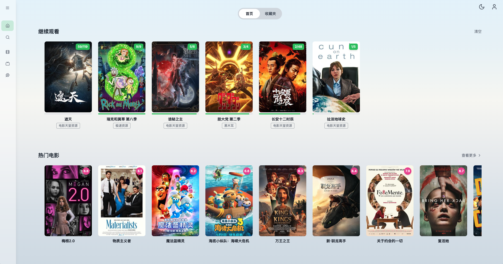
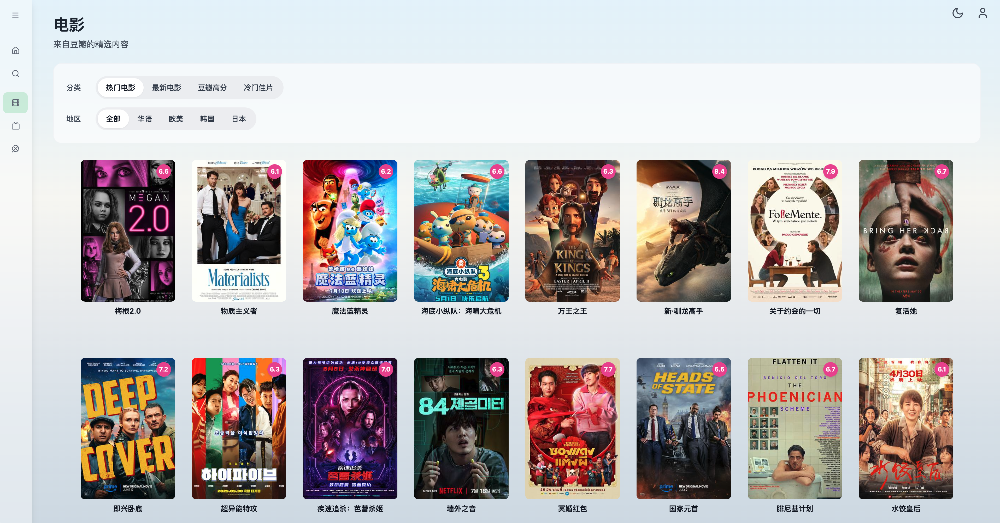
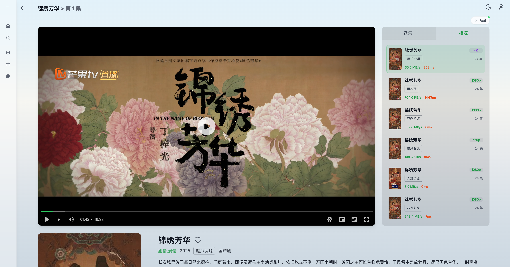

# LunaTV-lxy

基于 [MoonTechLab/LunaTV](https://github.com/MoonTechLab/LunaTV) 二开，保留原项目许可证及署名。

本分支围绕「界面更简洁、手机看剧更方便、播放等待有反馈、Cloudflare 访问更轻量」进行二次开发。以下列出已实现的新增功能与优化；原项目功能和部署说明保留在后文。

## 二开新增与优化

### 首页与界面

- **双风格切换**：默认 Hello Kitty 甜心粉，保留经典深色影院；顶部调色盘或头像菜单「外观风格」可随时切换。粉色款可选樱花粉、糖果紫、蜜桃粉强调色，使用轻量矢量图标与 CSS 装饰，视频画面保持原色。外观按账号保存在当前浏览器，不跨设备同步。

- **深色影视门户风格**：大幅精选 Banner、焦点推荐、竖版海报和响应式片单，统一绿色强调色与卡片样式。
- **更明显的搜索入口**：首页顶部突出搜索框，方便直接搜索电影和剧集。
- **顶部加载反馈**：点击影片、查找资源与页面跳转时，顶部及时显示加载状态。
- **首页浮动工具**：继续观看和资源服务检测收纳到浮动入口，点击展开；手机端单独适配，减少首页常驻内容。
- **停用新番放送入口**：移除不可用入口，减少无效操作。

### 默认播放源与选源

- **个人默认源**：头像菜单新增「默认播放源」，可检测接口响应时间后设置；后续优先使用该源搜索、加载影片，减少每次全源查找和测速的等待。
- **失败后临时换源**：默认源找不到影片或实际播放出现问题时提示，并提供选源测速窗口。临时选择其他源不会修改账号默认源。
- **渐进式选源弹窗**：展示影片信息，预先铺好配置源的占位卡片，再逐步更新搜索和测速结果；采用响应式 Grid，避免结果逐个出现时反复跳动。
- **速度与推荐标识**：展示可测得的速度、延迟、清晰度，并突出标记当前最快节点。选源弹窗中，只有测速成功且有对应资源的节点可以选择。
- **详情页后台找源**：先加载已知播放源，再后台查找其他匹配源、检测当前集速度；保留手动重新测速入口，标注「默认」「当前」和「最快」。详情页中的测速未完成不直接等同于源不可播放，允许尝试其他有当前集的源。
- **继续观看沿用上次来源**：优先恢复上次的播放源、集数和进度，加载失败后再提示换源；详情页换源尽量保留当前集数和位置。

### 手机、iPad 与播放详情页

- **选集优先的 Tab**：手机和平板使用「选集 / 换源 / 设置」，默认显示选集；点击在原位置切换内容，不使用锚点滚动定位。
- **切换不中断播放**：Tab 切换保留设置内容、测速结果与播放器状态，无需重新加载视频。
- **收起侧边菜单**：播放详情页在手机、平板等较窄屏幕下默认隐藏左侧导航，顶部按钮可展开抽屉菜单；展开时覆盖页面，不挤占视频宽度。
- **播放器按比例缩放**：较窄屏幕下使用视频比例展示，压缩页边距和卡片；电脑大屏继续在播放器右侧同时显示选集、播放设置和换源列表。

### 自动跳过与连播

- **按影片设置片头片尾**：支持填写跳过秒数、套用 90 秒模板，或把当前播放位置标记为正片开始、片尾开始；保存后后续各集沿用。
- **自动播放下一集**：默认开启连播，有下一集时在结束或片尾规则触发后提供倒计时，可取消或立即播放。
- **播放状态兼容**：暂停、手动切集时协调倒计时；对短视频及不合理的跳过时长进行校验。

> 跳过片头片尾按设置的秒数执行，不是自动识别剧情；浏览器阻止自动播放时，仍需点击播放器继续。

### 用户观看与管理员管理

- **大家在看**：首页显示最近观看摘要，左侧提供独立入口；按用户展示最近观看资源，每人最多 10 部，相同影片合并展示，支持按用户名筛选。
- **管理员查看观看情况**：用户管理中展示各用户最近在看的影片、集数与观看时间。
- **管理员修改默认源**：既可单独修改任意用户的默认播放源，也可统一设置全部用户；服务端按用户的采集源权限校验，统一设置仅展示所有目标用户共同可用的源。
- **默认源保存到账号**：数据库模式支持跨浏览器、跨设备同步；用户可修改自己的，管理员也可修改，以最后一次成功保存为准。
- **兼容浏览器旧设置**：首次同步可迁移旧偏好，管理员已设置或明确清除的默认源不会被浏览器旧值覆盖。进入页面、切回页面及页面可见期间每分钟同步，不打断正在播放的影片。

> 跨用户观看记录、管理员统一配置和账号默认源同步需要数据库存储模式；本地存储模式的个人默认源仍保存在当前浏览器。

### 服务检测与性能优化

- **接口状态可视化**：显示源名称、响应耗时和状态条，按绿色、黄色、橙色、红色区分快慢与不可用；支持刷新和查看详情，单个服务也会填满可用宽度。
- **海报压缩与缓存**：常用海报缩小为 240px WebP，Banner 使用较大尺寸；提供浏览器缓存、共享缓存和 ETag，并使用可供 Cloudflare 识别的图片路径。
- **减少首屏请求**：隐藏面板按需下载，下方片单接近可视区域后再加载；首页推荐在同一标签页内短时缓存，减少重复请求。
- **合并重复请求**：海报和同源影片详情复用短时缓存，合并并发请求；限制图片下载、解码和资源检测的并发量，避免请求集中拥堵。
- **缩短播放前等待**：已知源优先加载、替代源后台查找、成功的节点测速短时复用；继续观看和默认源路径减少不必要的全源测速。
- **保留数据隔离**：账号信息、观看记录和受权限校验的详情接口使用动态响应；共享图片缓存只用于公开海报，不对整站 API 开启公开缓存。

> 服务检测中的毫秒数是服务器访问资源接口的耗时；播放节点测速反映对应视频链接的检测结果，两者不是同一指标。Cloudflare 链路、源站带宽及第三方视频源仍会影响实际体验，详见 [Cloudflare 免费版提速说明](docs/cloudflare-performance.md)。

### 内置配置与部署

- 内置 **17 个视频源、14 个分类**，见 [default-catalog.json](src/lib/default-catalog.json)。新部署自动初始化；已有数据库配置不会被覆盖，如需更新，可在后台配置文件中导入该 JSON。第三方源可用性会变化，可在后台自行维护。
- 使用本分支镜像：`ghcr.io/lxy1338832064-byte/lunatv-lxy:latest`（仓库 Actions 构建成功后可用）。下方部署示例已切换到本分支镜像。
- Cloudflare 域名代理或 Tunnel 转发前，应以生产模式运行 Node.js / Docker 服务；本项目不是直接上传 Cloudflare Pages 的纯静态站点。
- 本地环境变量、账号密码、Redis 数据和临时截图均不随源码提交。

---

# MoonTV

<div align="center">
  
</div>

> 🎬 **MoonTV** 是一个开箱即用的、跨平台的影视聚合播放器。它基于 **Next.js 14** + **Tailwind&nbsp;CSS** + **TypeScript** 构建，支持多资源搜索、在线播放、收藏同步、播放记录、云端存储，让你可以随时随地畅享海量免费影视内容。

<div align="center">


</div>

---

## ✨ 功能特性

- 🔍 **多源聚合搜索**：一次搜索立刻返回全源结果。
- 📄 **丰富详情页**：支持剧集列表、演员、年份、简介等完整信息展示。
- ▶️ **流畅在线播放**：集成 HLS.js & ArtPlayer。
- ❤️ **收藏 + 继续观看**：支持 Kvrocks/Redis/Upstash 存储，多端同步进度。
- 📱 **PWA**：离线缓存、安装到桌面/主屏，移动端原生体验。
- 🌗 **响应式布局**：桌面侧边栏 + 移动底部导航，自适应各种屏幕尺寸。
- 👿 **智能去广告**：自动跳过视频中的切片广告（实验性）。

### 本分支已内置视频源配置；直播源仍需自行配置，已有数据库配置不会自动覆盖

<details>
  <summary>点击查看项目截图</summary>
  
  
  
</details>

### 请不要在 B 站、小红书、微信公众号、抖音、今日头条或其他中国大陆社交平台发布视频或文章宣传本项目，不授权任何“科技周刊/月刊”类项目或站点收录本项目。

## 🗺 目录

- [技术栈](#技术栈)
- [部署](#部署)
  - [一键部署](#zeabur-一键部署)
  - [Docker 部署](#Kvrocks-存储推荐)
- [配置文件](#配置文件)
- [订阅](#订阅)
- [自动更新](#自动更新)
- [环境变量](#环境变量)
- [客户端](#客户端)
- [AndroidTV 使用](#AndroidTV-使用)
- [Roadmap](#roadmap)
- [安全与隐私提醒](#安全与隐私提醒)
- [License](#license)
- [致谢](#致谢)

## 技术栈

| 分类      | 主要依赖                                                                                              |
| --------- | ----------------------------------------------------------------------------------------------------- |
| 前端框架  | [Next.js 14](https://nextjs.org/) · App Router                                                        |
| UI & 样式 | [Tailwind&nbsp;CSS 3](https://tailwindcss.com/)                                                       |
| 语言      | TypeScript 4                                                                                          |
| 播放器    | [ArtPlayer](https://github.com/zhw2590582/ArtPlayer) · [HLS.js](https://github.com/video-dev/hls.js/) |
| 代码质量  | ESLint · Prettier · Jest                                                                              |
| 部署      | Docker                                                                                                |

## 部署

本项目**仅支持 Docker 或其他基于 Docker 的平台** 部署。

### zeabur 一键部署

点击下方按钮即可一键部署，自动配置 LunaTV + Kvrocks 数据库：

[](https://zeabur.com/templates/8MPTQU/deploy)

**优势**：

- ✅ 无需配置，一键启动（自动部署完整环境）
- ✅ 自动 HTTPS 和全球 CDN 加速
- ✅ 持久化存储，数据永不丢失
- ✅ 免费额度足够个人使用

**⚠️ 重要提示**：部署完成后，需要在 Zeabur 中为 LunaTV 服务设置访问域名（Domain）才能在浏览器中访问。详见下方 [设置访问域名](#5-设置访问域名必须) 步骤。

### Kvrocks 存储（推荐）

```yml
services:
  moontv-core:
    image: ghcr.io/lxy1338832064-byte/lunatv-lxy:latest
    container_name: moontv-core
    restart: on-failure
    ports:
      - '3000:3000'
    environment:
      - USERNAME=admin
      - PASSWORD=admin_password
      - NEXT_PUBLIC_STORAGE_TYPE=kvrocks
      - KVROCKS_URL=redis://moontv-kvrocks:6666
    networks:
      - moontv-network
    depends_on:
      - moontv-kvrocks
  moontv-kvrocks:
    image: apache/kvrocks
    container_name: moontv-kvrocks
    restart: unless-stopped
    volumes:
      - kvrocks-data:/var/lib/kvrocks
    networks:
      - moontv-network
networks:
  moontv-network:
    driver: bridge
volumes:
  kvrocks-data:
```

### Redis 存储（有一定的丢数据风险）

```yml
services:
  moontv-core:
    image: ghcr.io/lxy1338832064-byte/lunatv-lxy:latest
    container_name: moontv-core
    restart: on-failure
    ports:
      - '3000:3000'
    environment:
      - USERNAME=admin
      - PASSWORD=admin_password
      - NEXT_PUBLIC_STORAGE_TYPE=redis
      - REDIS_URL=redis://moontv-redis:6379
    networks:
      - moontv-network
    depends_on:
      - moontv-redis
  moontv-redis:
    image: redis:alpine
    container_name: moontv-redis
    restart: unless-stopped
    networks:
      - moontv-network
    # 请开启持久化，否则升级/重启后数据丢失
    volumes:
      - ./data:/data
networks:
  moontv-network:
    driver: bridge
```

### Upstash 存储

1. 在 [upstash](https://upstash.com/) 注册账号并新建一个 Redis 实例，名称任意。
2. 复制新数据库的 **HTTPS ENDPOINT 和 TOKEN**
3. 使用如下 docker compose

```yml
services:
  moontv-core:
    image: ghcr.io/lxy1338832064-byte/lunatv-lxy:latest
    container_name: moontv-core
    restart: on-failure
    ports:
      - '3000:3000'
    environment:
      - USERNAME=admin
      - PASSWORD=admin_password
      - NEXT_PUBLIC_STORAGE_TYPE=upstash
      - UPSTASH_URL=上面 https 开头的 HTTPS ENDPOINT
      - UPSTASH_TOKEN=上面的 TOKEN
```

### ☁️ Zeabur 部署（推荐）

Thanks to @SzeMeng76

Zeabur 是一站式云端部署平台，使用预构建的 Docker 镜像可以快速部署，无需等待构建。

**部署步骤：**

1. **添加 KVRocks 服务**（先添加数据库）

   - 点击 "Add Service" > "Docker Images"
   - 输入镜像名称：`apache/kvrocks`
   - 配置端口：`6666` (TCP)
   - **记住服务名称**（通常是 `apachekvrocks`）
   - **配置持久化卷（重要）**：
     - 在服务设置中找到 "Volumes" 部分
     - 点击 "Add Volume" 添加新卷
     - Volume ID: `kvrocks-data`（可自定义，仅支持字母、数字、连字符）
     - Path: `/var/lib/kvrocks/db`
     - 保存配置

   > 💡 **重要提示**：持久化卷路径必须设置为 `/var/lib/kvrocks/db`（KVRocks 数据目录），这样配置文件保留在容器内，数据库文件持久化，重启后数据不会丢失！

2. **添加 LunaTV 服务**

   - 点击 "Add Service" > "Docker Images"
   - 输入镜像名称：`ghcr.io/lxy1338832064-byte/lunatv-lxy:latest`
   - 配置端口：`3000` (HTTP)

3. **配置环境变量**

   在 LunaTV 服务的环境变量中添加：

   ```env
   # 必填：管理员账号
   USERNAME=admin
   PASSWORD=your_secure_password

   # 必填：存储配置
   NEXT_PUBLIC_STORAGE_TYPE=kvrocks
   KVROCKS_URL=redis://apachekvrocks:6666

   # 可选：站点配置
   SITE_BASE=https://your-domain.zeabur.app
   NEXT_PUBLIC_SITE_NAME=LunaTV Enhanced
   ANNOUNCEMENT=欢迎使用 LunaTV Enhanced Edition

   # 可选：豆瓣代理配置（推荐）
   NEXT_PUBLIC_DOUBAN_PROXY_TYPE=cmliussss-cdn-tencent
   NEXT_PUBLIC_DOUBAN_IMAGE_PROXY_TYPE=cmliussss-cdn-tencent
   ```

   **注意**：

   - 使用服务名称作为主机名：`redis://apachekvrocks:6666`
   - 如果服务名称不同，请替换为实际名称
   - 两个服务必须在同一个 Project 中

4. **部署完成**
   - Zeabur 会自动拉取镜像并启动服务
   - 等待服务就绪后，需要手动设置访问域名（见下一步）

#### 5. 设置访问域名（必须）

- 在 LunaTV 服务页面，点击 "Networking" 或 "网络" 标签
- 点击 "Generate Domain" 生成 Zeabur 提供的免费域名（如 `xxx.zeabur.app`）
- 或者绑定自定义域名：
  - 点击 "Add Domain" 添加你的域名
  - 按照提示配置 DNS CNAME 记录指向 Zeabur 提供的目标地址
- 设置完域名后即可通过域名访问 LunaTV

6. **绑定自定义域名（可选）**
   - 在服务设置中点击 "Domains"
   - 添加你的自定义域名
   - 配置 DNS CNAME 记录指向 Zeabur 提供的域名

#### 🔄 更新 Docker 镜像

当 Docker 镜像有新版本发布时，Zeabur 不会自动更新。需要手动触发更新。

**更新步骤：**

1. **进入服务页面**

   - 点击需要更新的服务（LunaTV 或 KVRocks）

2. **重启服务**
   - 点击 **"服务状态"** 页面，再点击 **"重启当前版本"** 按钮
   - Zeabur 会自动拉取最新的 `latest` 镜像并重新部署

> 💡 **提示**：
>
> - 使用 `latest` 标签时，Restart 会自动拉取最新镜像
> - 生产环境推荐使用固定版本标签（如 `v5.5.6`）避免意外更新

## 配置文件

完成部署后为空壳应用，无播放源，需要站长在管理后台的配置文件设置中填写配置文件（后续会支持订阅）

配置文件示例如下：

```json
{
  "cache_time": 7200,
  "api_site": {
    "dyttzy": {
      "api": "http://xxx.com/api.php/provide/vod",
      "name": "示例资源",
      "detail": "http://xxx.com"
    }
    // ...更多站点
  },
  "custom_category": [
    {
      "name": "华语",
      "type": "movie",
      "query": "华语"
    }
  ]
}
```

- `cache_time`：接口缓存时间（秒）。
- `api_site`：你可以增删或替换任何资源站，字段说明：
  - `key`：唯一标识，保持小写字母/数字。
  - `api`：资源站提供的 `vod` JSON API 根地址。
  - `name`：在人机界面中展示的名称。
  - `detail`：（可选）部分无法通过 API 获取剧集详情的站点，需要提供网页详情根 URL，用于爬取。
- `custom_category`：自定义分类配置，用于在导航中添加个性化的影视分类。以 type + query 作为唯一标识。支持以下字段：
  - `name`：分类显示名称（可选，如不提供则使用 query 作为显示名）
  - `type`：分类类型，支持 `movie`（电影）或 `tv`（电视剧）
  - `query`：搜索关键词，用于在豆瓣 API 中搜索相关内容

custom_category 支持的自定义分类已知如下：

- movie：热门、最新、经典、豆瓣高分、冷门佳片、华语、欧美、韩国、日本、动作、喜剧、爱情、科幻、悬疑、恐怖、治愈
- tv：热门、美剧、英剧、韩剧、日剧、国产剧、港剧、日本动画、综艺、纪录片

也可输入如 "哈利波特" 效果等同于豆瓣搜索

MoonTV 支持标准的苹果 CMS V10 API 格式。

## 订阅

将完整的配置文件 base58 编码后提供 http 服务即为订阅链接，可在 MoonTV 后台/Helios 中使用。

## 自动更新

可借助 [watchtower](https://github.com/containrrr/watchtower) 自动更新镜像容器

dockge/komodo 等 docker compose UI 也有自动更新功能

## 环境变量

| 变量                                | 说明                     | 可选值                   | 默认值                                                                                                                     |
| ----------------------------------- | ------------------------ | ------------------------ | -------------------------------------------------------------------------------------------------------------------------- |
| USERNAME                            | 站长账号                 | 任意字符串               | 无默认，必填字段                                                                                                           |
| PASSWORD                            | 站长密码                 | 任意字符串               | 无默认，必填字段                                                                                                           |
| SITE_BASE                           | 站点 url                 | 形如 https://example.com | 空                                                                                                                         |
| NEXT_PUBLIC_SITE_NAME               | 站点名称                 | 任意字符串               | MoonTV                                                                                                                     |
| ANNOUNCEMENT                        | 站点公告                 | 任意字符串               | 本网站仅提供影视信息搜索服务，所有内容均来自第三方网站。本站不存储任何视频资源，不对任何内容的准确性、合法性、完整性负责。 |
| NEXT_PUBLIC_STORAGE_TYPE            | 播放记录/收藏的存储方式  | redis、kvrocks、upstash  | 无默认，必填字段                                                                                                           |
| KVROCKS_URL                         | kvrocks 连接 url         | 连接 url                 | 空                                                                                                                         |
| REDIS_URL                           | redis 连接 url           | 连接 url                 | 空                                                                                                                         |
| UPSTASH_URL                         | upstash redis 连接 url   | 连接 url                 | 空                                                                                                                         |
| UPSTASH_TOKEN                       | upstash redis 连接 token | 连接 token               | 空                                                                                                                         |
| NEXT_PUBLIC_SEARCH_MAX_PAGE         | 搜索接口可拉取的最大页数 | 1-50                     | 5                                                                                                                          |
| NEXT_PUBLIC_DOUBAN_PROXY_TYPE       | 豆瓣数据源请求方式       | 见下方                   | direct                                                                                                                     |
| NEXT_PUBLIC_DOUBAN_PROXY            | 自定义豆瓣数据代理 URL   | url prefix               | (空)                                                                                                                       |
| NEXT_PUBLIC_DOUBAN_IMAGE_PROXY_TYPE | 豆瓣图片代理类型         | 见下方                   | direct                                                                                                                     |
| NEXT_PUBLIC_DOUBAN_IMAGE_PROXY      | 自定义豆瓣图片代理 URL   | url prefix               | (空)                                                                                                                       |
| NEXT_PUBLIC_DISABLE_YELLOW_FILTER   | 关闭色情内容过滤         | true/false               | false                                                                                                                      |
| NEXT_PUBLIC_FLUID_SEARCH            | 是否开启搜索接口流式输出 | true/ false              | true                                                                                                                       |

NEXT_PUBLIC_DOUBAN_PROXY_TYPE 选项解释：

- direct: 由服务器直接请求豆瓣源站
- cors-proxy-zwei: 浏览器向 cors proxy 请求豆瓣数据，该 cors proxy 由 [Zwei](https://github.com/bestzwei) 搭建
- cmliussss-cdn-tencent: 浏览器向豆瓣 CDN 请求数据，该 CDN 由 [CMLiussss](https://github.com/cmliu) 搭建，并由腾讯云 cdn 提供加速
- cmliussss-cdn-ali: 浏览器向豆瓣 CDN 请求数据，该 CDN 由 [CMLiussss](https://github.com/cmliu) 搭建，并由阿里云 cdn 提供加速
- custom: 用户自定义 proxy，由 NEXT_PUBLIC_DOUBAN_PROXY 定义

NEXT_PUBLIC_DOUBAN_IMAGE_PROXY_TYPE 选项解释：

- direct：由浏览器直接请求豆瓣分配的默认图片域名
- server：由服务器代理请求豆瓣分配的默认图片域名
- img3：由浏览器请求豆瓣官方的精品 cdn（阿里云）
- cmliussss-cdn-tencent：由浏览器请求豆瓣 CDN，该 CDN 由 [CMLiussss](https://github.com/cmliu) 搭建，并由腾讯云 cdn 提供加速
- cmliussss-cdn-ali：由浏览器请求豆瓣 CDN，该 CDN 由 [CMLiussss](https://github.com/cmliu) 搭建，并由阿里云 cdn 提供加速
- custom: 用户自定义 proxy，由 NEXT_PUBLIC_DOUBAN_IMAGE_PROXY 定义

## 客户端

v100.0.0 以上版本可配合 [Selene](https://github.com/MoonTechLab/Selene) 使用，移动端体验更加友好，数据完全同步

## AndroidTV 使用

目前该项目可以配合 [OrionTV](https://github.com/zimplexing/OrionTV) 在 Android TV 上使用，可以直接作为 OrionTV 后端

已实现播放记录和网页端同步

## 安全与隐私提醒

### 请设置密码保护并关闭公网注册

为了您的安全和避免潜在的法律风险，我们要求在部署时**强烈建议关闭公网注册**：

### 部署要求

1. **设置环境变量 `PASSWORD`**：为您的实例设置一个强密码
2. **仅供个人使用**：请勿将您的实例链接公开分享或传播
3. **遵守当地法律**：请确保您的使用行为符合当地法律法规

### 重要声明

- 本项目仅供学习和个人使用
- 请勿将部署的实例用于商业用途或公开服务
- 如因公开分享导致的任何法律问题，用户需自行承担责任
- 项目开发者不对用户的使用行为承担任何法律责任
- 本项目不在中国大陆地区提供服务。如有该项目在向中国大陆地区提供服务，属个人行为。在该地区使用所产生的法律风险及责任，属于用户个人行为，与本项目无关，须自行承担全部责任。特此声明

## License

[CC BY-NC-SA 4.0](LICENSE) © 2025 MoonTV & Contributors

本项目采用 [知识共享 署名-非商业性使用-相同方式共享 4.0 国际许可协议](https://creativecommons.org/licenses/by-nc-sa/4.0/deed.zh)：禁止任何商业化行为；任何衍生项目必须保留本项目地址与版权署名，并以相同协议开源。

## 致谢

- [ts-nextjs-tailwind-starter](https://github.com/theodorusclarence/ts-nextjs-tailwind-starter) — 项目最初基于该脚手架。
- [LibreTV](https://github.com/LibreSpark/LibreTV) — 由此启发，站在巨人的肩膀上。
- [ArtPlayer](https://github.com/zhw2590582/ArtPlayer) — 提供强大的网页视频播放器。
- [HLS.js](https://github.com/video-dev/hls.js) — 实现 HLS 流媒体在浏览器中的播放支持。
- [Zwei](https://github.com/bestzwei) — 提供获取豆瓣数据的 cors proxy
- [CMLiussss](https://github.com/cmliu) — 提供豆瓣 CDN 服务
- 感谢所有提供免费影视接口的站点。

## Star History

[](https://www.star-history.com/#MoonTechLab/LunaTV&Date)
